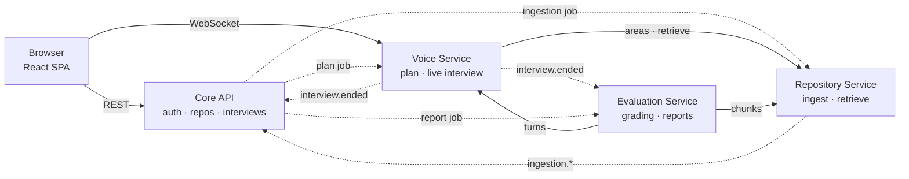

<div align="center">

# RepoViva

**Practise explaining the code you actually wrote.**

Connect a GitHub repository, answer spoken interview questions about it, and get a graded report that cites your files.

[**Try it live →**](https://15-134-29-83.sslip.io/)


</div>

---

## Why

Developers prepare with generic interview questions, then struggle to explain the projects they built. RepoViva interviews you about **your own repository**, out loud, and tells you where your explanation was right, vague or wrong.

## How it works

| Step | What happens |
|---|---|
| **1. Ingest** | The repository is cloned, chunked and embedded into pgvector. |
| **2. Plan** | One scenario question is written per major area of the code. |
| **3. Interview** | Questions are spoken (TTS) and your answers transcribed (STT) over a WebSocket. Up to 30 minutes. |
| **4. Report** | Each answer is scored for correctness and clarity against the code it was about, with key points linking to your files. |

## Architecture

Four Python services and a React app. Each service owns its data and talks to the others in one of three ways:

- **Queries** — the caller needs the answer → HMAC-signed HTTP
- **Jobs** — "do X" → an SQS queue, consumed by the owning service's worker
- **Events** — "X happened" → the EventBridge bus `repoviva`, one queue per consumer



<sub>Solid: HTTP queries (main ones only). Dotted: SQS jobs and EventBridge events.</sub>

| Service | Responsibility | Data | Port |
|---|---|---|---|
| [core-api](core-api/) | GitHub login, repositories, interviews; the frontend's REST API | Postgres | 8000 |
| [repository-service](repository-service/) | Clone, chunk, embed, retrieve | Postgres + pgvector | 8001 |
| [voice-service](voice-service/) | Question plan and live interview | MongoDB | 8002 |
| [evaluation-service](evaluation-service/) | Grading and reports | Postgres | 8003 |
| [frontend](frontend/) | Web app | — | 5173 |
| [libs/repoviva-common](libs/repoviva-common/) | Shared infrastructure (HMAC, HTTP, messaging, request IDs) | — | — |

Every queue has a dead-letter queue, every job is idempotent, and an `X-Request-ID` follows each request through calls, messages and logs. More: [architecture](docs/architecture.md) · [decisions](docs/decisions.md).

## Tech stack

| Area | Tools |
|---|---|
| Backend | Python 3.11+, FastAPI, `uv`, pytest, ruff |
| Frontend | React, Vite, TypeScript |
| Messaging | AWS SQS + EventBridge (`boto3`), LocalStack locally |
| Data | PostgreSQL 16 + pgvector, MongoDB |
| Ingestion | CocoIndex chunking, Voyage `voyage-4-lite` embeddings |
| LLMs (Groq) | `qwen/qwen3.8-27b` for planning, `openai/gpt-oss-120b` for grading |
| Speech | Groq Whisper (STT), Deepgram Aura-2 (TTS) |
| Deployment | Docker Compose on AWS EC2, Caddy (HTTPS), Neon, MongoDB Atlas |

## Getting started

### 1. Install

Prerequisites: Python 3.11+, [`uv`](https://docs.astral.sh/uv/), Docker, Node.js 20+, Git.

```bash
git clone https://github.com/missLaiba22/RepoViva.git && cd RepoViva
docker compose up -d     # Postgres, MongoDB, LocalStack (queues, bus, rules)

for s in core-api repository-service voice-service evaluation-service; do (cd $s && uv sync); done
(cd core-api && uv run alembic upgrade head)
(cd frontend && npm install)
```

### 2. Configure

Copy `.env.example` to `.env` in each service and in `frontend`. The defaults already point at the local containers; you only need these:

| Key | Service | Where to get it |
|---|---|---|
| `INTERNAL_HMAC_SECRET` | all four (same value) | `python -c "import secrets; print(secrets.token_hex(32))"` |
| `GITHUB_CLIENT_ID` / `_SECRET` | core-api | [GitHub OAuth app](https://github.com/settings/developers), callback `http://localhost:8000/v1/auth/github/callback` |
| `COOKIE_SECRET`, `TOKEN_ENCRYPTION_KEY` | core-api | two more generated strings |
| `VOYAGE_API_KEY` | repository-service | [Voyage AI](https://dash.voyageai.com) |
| `GROQ_API_KEY` | voice, evaluation | [Groq console](https://console.groq.com/keys) (free tier) |
| `DEEPGRAM_API_KEY` | voice-service | [Deepgram console](https://console.deepgram.com) |

> **Windows:** use `127.0.0.1` instead of `localhost` in service URLs; `localhost` adds about 2 s per call.

### 3. Run

Each backend service runs an API and a worker. Give each line its own terminal:

```bash
cd core-api           && uv run uvicorn core_api.main:app --port 8000
cd core-api           && uv run python -m core_api.worker
cd repository-service && uv run uvicorn repository_service.main:app --port 8001
cd repository-service && uv run python -m repository_service.worker
cd voice-service      && uv run uvicorn voice_service.main:app --port 8002
cd voice-service      && uv run python -m voice_service.worker
cd evaluation-service && uv run uvicorn evaluation_service.main:app --port 8003
cd evaluation-service && uv run python -m evaluation_service.worker
cd frontend           && npm run dev
```

Open **http://localhost:5173**, sign in with GitHub, connect a public repository, start an interview once it's ready, and open the report when grading finishes.

## Deployment

Live at **[15-134-29-83.sslip.io](https://15-134-29-83.sslip.io/)**.

One EC2 instance runs [`docker-compose.prod.yml`](docker-compose.prod.yml). Each service image runs as an API and a worker; Caddy serves the frontend, routes `/v1/ws/*` to Voice Service and `/v1/*` to Core API, and terminates HTTPS. SQS and EventBridge are real AWS, Postgres is Neon, MongoDB is Atlas. Setup guide: [infra/aws/README.md](infra/aws/README.md).

## Limits

- Public GitHub repositories only.
- Groq's free tier fits one live interview at a time and about 10 reports a day.
- No CI yet.
