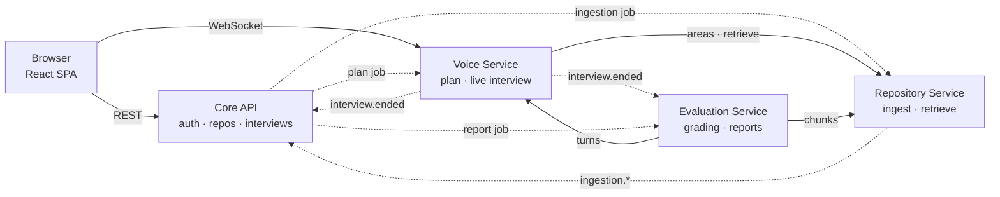

# RepoViva

A voice-based interview coach for developers: connect a GitHub repository, answer spoken interview questions about your own code, and get a graded report.

**Live:** [https://15-134-29-83.sslip.io](https://15-134-29-83.sslip.io/)

## Why

Developers prepare with generic interview questions but struggle to explain the projects they actually built. RepoViva lets you practise talking about your own code.

## How it works

1. **Ingest:** the repository is cloned, chunked and embedded (pgvector); the clone is deleted when ingestion ends. A failed repository can be retried in place.
2. **Plan:** when you start an interview, one scenario question is written per major area of the code (the largest areas are split until there are enough questions).
3. **Interview:** questions are spoken (TTS) and your answers transcribed (STT) over a WebSocket. The live page waits for the plan, shows question progress, and a session ends after 30 minutes at most.
4. **Report:** each answer is scored for correctness and clarity against the code it was asked about, with key points citing your files.

## Architecture

Four Python services in a monorepo plus a React frontend. Each service owns its data and talks to the others in one of three ways (decision 057):

- **Queries** (the caller needs the answer): HMAC-signed HTTP.
- **Jobs** ("do X"): an SQS queue, consumed by the owning service's worker.
- **Events** ("X happened"): the EventBridge bus `repoviva`, routed to one SQS queue per consumer.

Every queue has a dead-letter queue, every job is idempotent, and every request carries an `X-Request-ID` through calls, messages and logs.



*Solid: HTTP queries (only the main ones shown). Dotted: SQS jobs and EventBridge events.*

| Service | Owns | Data | Port |
|---|---|---|---|
| [core-api](core-api/) | GitHub OAuth, users, repositories, interviews; the frontend's only REST API | Postgres | 8000 |
| [repository-service](repository-service/) | Clone, chunk, embed, retrieve | Postgres + pgvector | 8001 |
| [voice-service](voice-service/) | Question planning and the live interview | MongoDB | 8002 |
| [evaluation-service](evaluation-service/) | Grading and reports | Postgres | 8003 |
| [frontend](frontend/) | React + Vite + TypeScript SPA | — | 5173 |

Each backend service runs an API and a worker from the same code. Details: [docs/architecture.md](docs/architecture.md); reasoning: [docs/decisions.md](docs/decisions.md).

## Tech stack

- **Backend:** Python 3.11+, FastAPI, `uv`, pytest, ruff; shared infrastructure in [`libs/repoviva-common`](libs/repoviva-common/) (HMAC, HTTP client, messaging, logging, request IDs)
- **Frontend:** React, Vite, TypeScript
- **Messaging:** AWS SQS + EventBridge via `boto3`; LocalStack locally
- **Data:** PostgreSQL 16 + pgvector, MongoDB (Neon and Atlas in production)
- **Ingestion:** CocoIndex chunking, Voyage `voyage-4-lite` embeddings
- **LLMs (Groq):** `qwen/qwen3.8-27b` for question planning, `openai/gpt-oss-120b` for grading
- **Speech:** Groq Whisper `whisper-large-v3-turbo` (STT), Deepgram Aura-2 (TTS)
- **Deployment:** Docker Compose on one AWS EC2 instance, Caddy for HTTPS and routing

## Installation

Prerequisites: Python 3.11+, [`uv`](https://docs.astral.sh/uv/), Docker, Node.js, Git.

```bash
git clone https://github.com/missLaiba22/RepoViva.git && cd RepoViva

# Postgres, MongoDB and LocalStack (creates the queues, bus and rules)
docker compose up -d

# Python dependencies for each service
for s in core-api repository-service voice-service evaluation-service; do (cd $s && uv sync); done

# Core API's database schema
cd core-api && uv run alembic upgrade head && cd ..

# Frontend dependencies
cd frontend && npm install && cd ..
```

## Configuration and API keys

Copy each service's `.env.example` to `.env` (`core-api`, `repository-service`, `voice-service`, `evaluation-service`, `frontend`). The examples already point at the local Docker containers and LocalStack; fill in the following:

| Setting | Where | How to get it |
|---|---|---|
| `INTERNAL_HMAC_SECRET` | all four services, **identical** | `python -c "import secrets; print(secrets.token_hex(32))"` |
| `GITHUB_CLIENT_ID`, `GITHUB_CLIENT_SECRET` | core-api | GitHub → Settings → Developer settings → OAuth Apps. Callback URL: `http://localhost:8000/v1/auth/github/callback` |
| `COOKIE_SECRET`, `TOKEN_ENCRYPTION_KEY` | core-api | two more generated random strings |
| `VOYAGE_API_KEY` | repository-service | [dash.voyageai.com](https://dash.voyageai.com) |
| `GROQ_API_KEY` | voice-service, evaluation-service | [console.groq.com/keys](https://console.groq.com/keys) (free tier) |
| `DEEPGRAM_API_KEY` | voice-service | [console.deepgram.com](https://console.deepgram.com) |

Optional tuning in voice-service: `MAX_QUESTIONS` (default 6), `MAX_ANSWER_SECONDS` (180). The `AWS_*` endpoint and test keys are for LocalStack only; leave them unset on AWS.

On Windows, use `127.0.0.1` rather than `localhost` in service URLs (`localhost` adds about 2 s per call).

## Running locally

Each service runs an API and a worker; give each command its own terminal.

```bash
cd core-api && uv run uvicorn core_api.main:app --port 8000
cd core-api && uv run python -m core_api.worker
cd repository-service && uv run uvicorn repository_service.main:app --port 8001
cd repository-service && uv run python -m repository_service.worker
cd voice-service && uv run uvicorn voice_service.main:app --port 8002
cd voice-service && uv run python -m voice_service.worker
cd evaluation-service && uv run uvicorn evaluation_service.main:app --port 8003
cd evaluation-service && uv run python -m evaluation_service.worker
cd frontend && npm run dev
```

Then open http://localhost:5173:

1. Log in with GitHub.
2. Add a public repository and wait until it is ready.
3. Start an interview, pass the audio check, and answer the questions aloud.
4. Open the report from the Reports page once grading finishes.

Checks: `cd <service> && uv run ruff check . && uv run pytest` · `cd frontend && npm run lint && npm test`.

## Deployment

Live at **[https://15-134-29-83.sslip.io](https://15-134-29-83.sslip.io/)**.

One EC2 instance runs [`docker-compose.prod.yml`](docker-compose.prod.yml): each service's image runs as API and worker, and Caddy serves the frontend, routes `/v1/ws/*` to Voice Service and `/v1/*` to Core API, and terminates HTTPS. SQS and EventBridge are real AWS; Postgres is Neon and MongoDB is Atlas (decision 063). Setup steps: [infra/aws/README.md](infra/aws/README.md).

## Limits

- Public GitHub repositories only.
- Groq's free tier fits one live interview at a time and about 10 reports a day.
- No CI yet.
