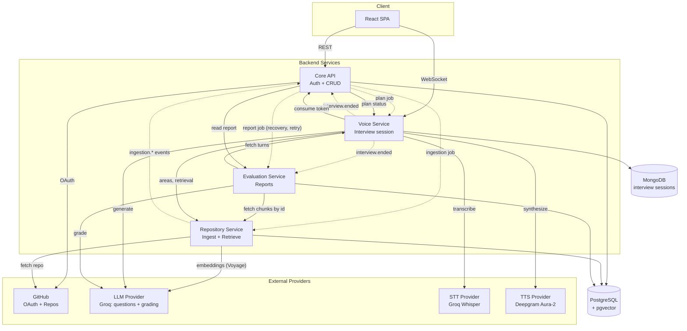

# Architecture

## Overview

RepoViva is built as **4 microservices**. Queries go over HMAC-signed HTTP, jobs over SQS, and events over an EventBridge bus (decision 057); the interview session uses a WebSocket. Requirements, core entities, service split, and key architectural constraints have been decided. The speech providers are chosen: Groq for question generation (decision 038) and STT (decision 043), Deepgram for TTS (decision 044). The full data model is still open.

This document is the source of truth for the current architecture. See `decisions.md` for the reasoning behind each choice.

## Architecture Diagram



*Solid arrows are HMAC-signed HTTP queries. Dotted arrows go through SQS: jobs straight to the worker's queue, events through the EventBridge bus `repoviva` into one queue per consumer (decision 057). All arrows are implemented.*

## Components

### Core API service

Main REST entry point for the frontend. Owns:

- GitHub OAuth flow and session management
- User records
- Repository metadata (with ingestion status)
- Interview metadata (creation, listing, session token issuance and consumption)
- Report access for the frontend: checks ownership, then proxies to Evaluation Service, which owns the report and its status (decision 049)

Delegates:

- Ingestion → Repository Service (an `ingestion-jobs` job)
- Question planning → Voice Service (a `planning-jobs` job)
- Report recovery and retry → Evaluation Service (a `report-jobs` job; the normal path is Evaluation consuming `interview.ended`)
- Live interview session (WebSocket) → Voice Service

Runs an API and a worker. The worker consumes `interview.ended` and `ingestion.*` events to update interview and repository status.

### Repository Service

Owns everything about a repository's code and its searchable representation:

- Fetches the repository from GitHub
- Parses, chunks, and embeds source code
- Persists chunks + embeddings (pgvector) to the shared database
- Exposes the areas and retrieval endpoints Voice Service uses to plan interviews (decisions 052, 060)
- Publishes ingestion progress as `ingestion.*` events, which Core API consumes (decisions 029, 057)

Runs ingestion in a worker that consumes `ingestion-jobs`, separate from its API process. See "Data Flow" below.

### Voice Service

Owns the live interview session:

- Terminates the WebSocket from the frontend and admits it by consuming the session token through Core API (decision 035)
- Plans each interview's questions in a worker that consumes `planning-jobs`: it gets the repository's areas, retrieves 2 chunks per area and writes the whole ordered plan in one LLM call, one scenario-based question per area (decisions 048, 052, 060)
- Runs the live session from the stored plan: each question's audio is streamed to the client by TTS, then the candidate's audio goes to STT (decisions 043–045). There is no retrieval, no LLM call and no follow-up during the interview
- Persists each interview as one MongoDB document in `interview_sessions`: the plan, with each question's answer and timings stored on it (decision 053)
- Publishes `interview.ended` with outcome `completed` or `interrupted` when a session ends (decisions 041, 057). An interruption still leaves a partial record because answers are already persisted

### Evaluation Service

Generates the end-of-interview report (decisions 049–051):

- Its worker consumes `interview.ended` (`completed` or `interrupted`) and Core API's `report.requested` jobs for recovery and retry (decision 057)
- Fetches the turns from Voice Service and the exact code chunks each question came from (`retrieved_chunk_ids`) from Repository Service, over HMAC-signed HTTP
- Grades each answered turn in its own LLM call: correctness and clarity on 1–5, strengths, gaps, and 2–4 key points of a strong answer, each citing the turn's chunks. Citations are checked in code (decision 050)
- Writes a summary. Averages are computed in code, the prose by one more LLM call
- Stores the report in its own `reports` table and serves it to Core API
- An interrupted interview gets a partial report: unanswered turns are listed, not scored (decision 008)

Kept separate so report generation (slow, rate-limited) does not compete with live-session latency.

### PostgreSQL (shared, with pgvector)

Single database, shared by Core API, Repository Service and Evaluation Service (decision 021, as amended by 053). Each service owns its own tables — no service reads or writes another service's tables directly. Cross-service data access goes through HTTP APIs.

### MongoDB

Voice Service's own store for interview sessions (decision 053). Locally a container in `docker-compose.yml`; in production MongoDB Atlas (decision 063).

## Deployment (decision 063)

One EC2 instance runs `docker-compose.prod.yml`. Each service has one image (`<service>/Dockerfile`, built from the repo root), run twice: the API and its worker. Caddy (`frontend/Dockerfile`, `infra/caddy/Caddyfile`) serves the built frontend, proxies `/v1/ws/*` to Voice Service and `/v1/*` to Core API, and terminates HTTPS; it is the only published container. SQS and EventBridge are real AWS, reached with the instance's IAM role. Postgres is Neon and MongoDB is Atlas, in the instance's region. Secrets live in each service's `.env.prod`, never in an image. Setup steps: `infra/aws/README.md`.

## Core Entities

- **User** — the developer using RepoViva.
- **Repository** — a GitHub repo the user has connected.
- **Interview** — a mock interview session against a repository. Fields and lifecycle: decision 036.
- **Turn** — one question and its answer, treated as a single unit. Stored as a question in the interview's session document (decision 053).
- **Report** — the evaluation output at the end of an interview.

Fields per entity are deferred until each service's implementation clarifies exactly what state it must hold.

## API Surface

### REST — served by Core API (v1)

Auth
```
GET  /v1/auth/github/login       generates state cookie, redirects to GitHub
GET  /v1/auth/github/callback    validates state, exchanges code, sets session cookie
POST /v1/auth/github/logout      clears the session cookie (204)
GET  /v1/me                      returns the current user (requires session cookie)
```

Repositories
```
POST /v1/repositories            body: { github_url }  → Repository (status=queued or failed)
GET  /v1/repositories            list current user's repos
GET  /v1/repositories/{id}       single repo, including ingestion status
POST /v1/repositories/{id}/retry a failed repo goes back to `queued` and its ingestion
                                 job is sent again: 202; any other repo is returned as
                                 is: 200; 404 if missing or not yours (decision 061)
```

Interviews
```
POST /v1/interviews              body: { repository_id }  → Interview + session token   [implemented]
                                 201; 404 if repo missing or not yours; 409 if repo not `ready`
                                 The raw token appears ONLY in this response (decision 035)
                                 Also sends the `plan.requested` job (decisions 052, 057)
GET  /v1/interviews              list current user's interviews, newest first            [implemented]
GET  /v1/interviews/{id}         single interview; 404 if missing or not yours           [implemented]
GET  /v1/interviews/{id}/plan    question plan status, proxied from Voice Service;        [implemented]
                                 re-sends the job if Voice has none and the interview
                                 is `created`; 503 if Voice is down
POST /v1/interviews/{id}/plan/retry                                                      [implemented]
                                 re-sends the job for a missing or retryably failed plan;
                                 other plans are returned as is; 409 once started
GET  /v1/interviews/{id}/report  the report: 200 ready/failed, 202 generating,          [implemented]
                                 404 if missing, not yours or not ended (decision 049)
POST /v1/interviews/{id}/report/retry                                                    [implemented]
                                 re-sends the job for a failed or missing report: 202;
                                 a ready (200) or generating (202) report is returned
                                 as is; 404 as above
```

The current user is always derived from the auth token, never from request bodies.

### Internal service-to-service APIs

These are called only by other services, never exposed to the frontend. HTTP calls are queries, authenticated with HMAC-SHA256 (decision 027). Everything a caller doesn't wait for goes through SQS (decision 057, below).

**Jobs and events (decision 057).**

Every message, job or event, is the same envelope:
```
{ message_id: <uuid>, type: string, occurred_at: <ISO 8601 UTC>,
  request_id: string | null,   // decision 056; null if the sender had none
  data: { ... } }              // the contract: a Pydantic model on each side
```

Jobs (one consumer; sent straight to the worker's queue)
```
ingestion-jobs   ingestion.requested  { repository_id, github_url }               Core API → Repository Service
planning-jobs    plan.requested       { interview_id, repository_id }             Core API → Voice Service
report-jobs      report.requested     { interview_id, repository_id, outcome }    Core API → Evaluation Service
```

Events (published on the EventBridge bus `repoviva`; one rule per consumer
routes the event's `detail`, which is the envelope, into its own queue)
```
interview.ended      { interview_id, repository_id, outcome, error_message }
                     source repoviva.voice-service
                     → core-interview-events (Core API: interview status)
                     → evaluation-interview-events (Evaluation: report)
ingestion.started | ingestion.completed | ingestion.failed
                     { repository_id, error_message }
                     source repoviva.repository-service
                     → core-ingestion-events (Core API: repository status)
```

Each service runs a worker (`python -m <package>.worker`) from the same
image as its API. The worker long-polls its queues, runs one message at a
time per queue, and deletes a message only after its handler returns. A
heartbeat extends the visibility timeout while a long job runs. Every
queue has a DLQ (`maxReceiveCount` = 3). Jobs claim their stored state,
then run unless it is terminal, so a duplicate does nothing and a message
redelivered after a crash finishes the work. Event consumers treat a
rejected state transition (late or duplicate event) as handled. Publishing
is retried with backoff. `repoviva_common/messaging.py` is the only code
that touches SQS and EventBridge (`boto3`).

**Implemented (retrieval endpoint):**

Voice Service → Repository Service (retrieval)
```
POST /internal/v1/repositories/{repository_id}/retrieve
body: {
  query: string,
  top_k?: int = 10,               // 1-50
  filename_prefix?: string
}
→ 200 OK: { chunks: [ { id, content, filename, start_line, end_line,
                         language, similarity }, ... ] }
→ 401 Unauthorized (missing or invalid HMAC signature)
→ 422 Unprocessable Entity (malformed body — FastAPI's default
  validation response)
→ 502 Bad Gateway (embedding provider call failed)
```
Always 200 with `chunks: []` if nothing matches — Repository Service has
no local record of the user-visible ingestion status (that lives in Core
API, reached only through events, never queried back), so it cannot distinguish
"unknown repository_id" from "ingestion still running" from "done." Core
API already gates `POST /v1/interviews` on repo status `ready`, so by the
time this endpoint is called ingestion is expected to be complete. See
`decisions.md` for the full reasoning.

Nearest chunks are found via pgvector cosine distance (`<=>`) against
`code_chunks.embedding`, scoped to `repository_id` only — no `commit_sha`
filter, since no re-ingestion path exists yet and an interview session
references a repository, not a specific commit.

**Implemented (decision 035):**

Voice Service → Core API (session token consumption, once per session)
```
POST /internal/v1/session-tokens/consume
body: { token: string }            // 1–128 chars
→ 200 { interview_id, user_id, repository_id }
→ 403 { reason: "unknown" | "expired" | "consumed" }
→ 401 (bad HMAC)  → 422 (malformed body)
```
One conditional `UPDATE` both validates and consumes the token. It
requires the hash to match, the token to be unconsumed and unexpired,
and the interview's status to be `created`. The same statement moves the
interview to `active` (decision 036), so concurrent calls with the same
token can't both succeed. The endpoint is not idempotent: a second call
gets 403 `consumed`. Implementation notes are under decision 035.

**Implemented (decision 049).** Decision 049 has the full contract and recovery rules.

Core API → Evaluation Service (report read)
```
GET  /internal/v1/reports/{interview_id}
→ 200 { status: "generating" | "ready" | "failed", partial, summary,
        turn_evaluations, model, prompt_version, error_message }
→ 404 no report
```

Evaluation Service → Voice Service (turns)
```
GET /internal/v1/interviews/{interview_id}/turns
→ 200 { turns: [ { seq, question_text, answer_text, status, retrieved_chunk_ids } ] }
```

Evaluation Service → Repository Service (chunks by id)
```
POST /internal/v1/repositories/{repository_id}/chunks
body: { ids: int[] }   // 1–200
→ 200 { chunks: [ { id, content, filename, start_line, end_line, language } ] }
```

**Implemented (decision 052).**

Voice Service → Repository Service (areas, for question planning)
```
GET /internal/v1/repositories/{repository_id}/areas?limit=6   // 1–50
→ 200 { areas: [ { path, chunk_count } ] }   // largest first
→ 401 (bad HMAC)  → 422 (limit missing or out of range)
```
`path` is a directory ending in `/`, or a file when the level holds no
directories, so it can be passed straight to `/retrieve` as
`filename_prefix`. Always 200, with `areas: []` for a repository with no
chunks, like `/retrieve`.

**Implemented (decisions 052, 057; the live page doesn't use it yet).**

Planning starts with a `plan.requested` job `{ interview_id, repository_id }`
on SQS `planning-jobs`, sent by Core API on `POST /v1/interviews` and by
`POST /v1/interviews/{id}/plan/retry`. Voice Service's worker claims the
plan (new, or restarts a failed one) and plans unless it is `ready`.
Core API proxies the status as `GET /v1/interviews/{id}/plan`, and re-sends
the job if Voice has no plan for an interview that hasn't started.

Core API → Voice Service (question plan status)
```
GET  /internal/v1/interviews/{interview_id}/plan
→ 200 { interview_id, plan_status: "generating" | "ready" | "failed",
        error_message, retryable }
→ 404 planning never triggered
```
`retryable: false` means retrying can't help (the repository has no code),
so the page shows no Try again button. The questions themselves never
leave Voice Service.

### WebSocket — served by Voice Service

Interview turns are not REST. Once an interview is created by Core API, the client connects a WebSocket to the Voice Service, presenting the session token issued by Core API.

**Protocol v2: implemented (decisions 039, 045).** Endpoint
`ws://<voice-service>/v1/ws/interview`. JSON text frames shaped
`{ "type": ..., ...fields }` carry control messages; binary frames carry
audio.

```
Client → Server
  session.start  { token }          must be the first message, within 10 s
  <binary>                          answer audio: PCM16 LE, 16 kHz, mono
  audio.end      {}                 the frames since the last answer are one answer
  answer.text    { text }           1–5000 chars; typed fallback (dev, accessibility)
  session.end    {}                 user stops early → counts as completed (decision 041)

Server → Client
  session.ready       { interview_id, question_count }   the plan's length (decision 062)
  question.text       { seq, text }   sent before the audio, as captions
  <binary>                             question audio: PCM16 LE, 24 kHz, mono
  question.audio_end  { seq }          all audio sent; the client may open the mic
  transcript.final    { seq, text }    what STT heard
  turn.complete       { seq }          answer persisted
  session.end         { reason: "completed" | "ended_by_client" }
  error               { code, message }
```

Error codes that keep the socket open and the turn waiting:
`bad_message`, `no_speech` (empty audio or blank transcript),
`answer_too_long` (over `MAX_ANSWER_SECONDS`, default 180). `internal_error`
precedes a 1011 close.

`seq` is the question's position in the plan (decision 053; it replaced
`turn_id`, a Postgres row id). `plan_not_ready` precedes a 1008 close when
a session starts before its plan is ready, and the interview is reported
`interrupted` (decision 052). `session_time_limit` precedes a 1008 close
when a session reaches `MAX_SESSION_SECONDS` (default 1800), also reported
`interrupted` (decision 059).

Close codes: `1000` normal end · `1008` missing, invalid or rejected
token (one generic reason; the specific 403 reason is only logged,
decision 035), or plan not ready · `1011` internal failure (Core API unreachable at admission,
or the session failed mid-way, including an STT or TTS provider error).

## Data Flow

### Repository ingestion (decisions 029, 057)

1. User submits a GitHub URL via `POST /v1/repositories` (Core API).
2. Core API creates a Repository row with status `queued` and sends an
   `ingestion.requested` job `{ repository_id, github_url }` on
   `ingestion-jobs`. If the send fails, it marks the row `failed` with
   an `error_message` right away. Either way it returns 201 with the row.
3. Repository Service's worker receives the job and claims an
   `ingestion_jobs` row (each claim of an `in_progress` row counts an
   attempt; a `failed` row restarts as attempt 1, decision 061). If the
   row is already `ready`, it publishes that outcome again and stops; if
   it has crashed twice, it marks it `failed` and publishes
   `ingestion.failed` (decision 058). Otherwise it runs
   `run_ingestion(repository_id)`.
4. The pipeline publishes `ingestion.started` → shallow-clones the repo
   into `workspace/<repository_id>/` → walks, chunks, and embeds the
   source tree via a per-repository CocoIndex App (decision 031), writing
   rows to the shared `code_chunks` table → publishes
   `ingestion.completed` (or `ingestion.failed` with the fetch or
   indexing error). Pipeline errors end as `failed`; only a crash leaves
   the job `in_progress`, and SQS redelivers it. If the final event can't
   be published, the handler raises so SQS redelivers the job, which then
   publishes the stored outcome (decision 058).
5. Core API's worker applies the loose state machine on each event
   (decision 029): `queued`/`in_progress` move to
   `in_progress`/`ready`/`failed`; terminal states reject further events,
   which the worker treats as handled.
6. Client polls `GET /v1/repositories/{id}` to observe the current
   status: `queued → in_progress → ready`, or `→ failed` with
   `error_message`.
7. For a `failed` repository, `POST /v1/repositories/{id}/retry` moves the
   row back to `queued` with one conditional `UPDATE` and sends the job
   again (decision 061).

Chunking uses CocoIndex's syntax-aware `RecursiveSplitter`; embedding
is Voyage `voyage-4-lite` via CocoIndex's LiteLLM integration
(decision 030). `code_chunks`' DDL is owned by Repository Service
itself (`sql/schema.sql`, applied at startup), not by CocoIndex —
see decision 031 for why that split exists and what it fixed.

### Interview session (live, over WebSocket)

1. Client calls `POST /v1/interviews` on Core API (allowed only if repo status is `ready`). Core API creates the interview, sends a `plan.requested` job and returns a session token. The live page polls `GET /v1/interviews/{id}/plan`, shows "Preparing your interview…", and opens the WebSocket once the plan is `ready` (decision 052).
2. Client opens a WebSocket to Voice Service and sends the session token in its first message, `session.start` — not in the URL, which is commonly logged (decision 035).
3. Voice Service consumes the token via Core API's `/internal/v1/session-tokens/consume`. This happens once per session; it also moves the interview to `active` and returns its `repository_id`. Voice Service then loads the plan: if it isn't ready it sends `plan_not_ready` and closes 1008, otherwise it replies `session.ready` with `question_count` (decision 062).
4. **Each question:** mark the next planned question `asked` → send `question.text` → stream its audio from Deepgram as binary frames, then `question.audio_end` (decision 044).
5. The user answers. The client streams microphone audio as binary frames and sends `audio.end` when the user stops. Voice Service compresses the buffered audio to MP3 (decision 047) and transcribes it with Groq Whisper, using the question as prompt (decision 043), sends `transcript.final`, records the answer (question → `answered`) and sends `turn.complete`. Silence or an over-long answer gets an `error` and the turn waits for another try.
6. **Next question:** no retrieval and no LLM call; Voice Service asks the next question in the plan. Repeat until the plan is done or the client sends `session.end`. There are no follow-up questions (decision 052).
7. On session end, Voice Service publishes `interview.ended` with outcome `completed` (plan finished or user stopped) or `interrupted` (disconnect, error or the 30-minute limit) (decisions 036, 041, 057). Core API's worker ends the interview and Evaluation's worker starts the report (see below).
8. If Voice crashes or the event is lost, the interview stays `active` only until the user next reads it after `ACTIVE_SESSION_CUTOFF_SECONDS` (default 2100, above Voice's 30-minute session limit): Core API then ends it `interrupted`, and the first report read starts the report through the usual 404 recovery (decision 059).

Each question's `timings` records `tts_first_byte_ms`, `tts_ms` and `stt_ms`, and the same values are logged. Retrieval and the LLM call happen once, at planning time, so decision 006's latency path is now STT plus the next question's TTS first byte.

### Report generation (decisions 049–051)

1. Evaluation Service's worker receives `interview.ended` from its own queue (decision 057).
2. It claims the `reports` row (new, or a `failed` one restarted) and generates the report unless it is already `ready`.
3. It fetches the turns from Voice Service and their chunks from Repository Service.
4. It grades each answered turn with `gpt-oss-120b` on Groq, one call at a time with back-off on 429, then writes the summary. Status becomes `ready`, or `failed` with `error_message`.
5. The client polls `GET /v1/interviews/{id}/report` on Core API, which checks ownership and proxies to Evaluation Service. Evaluation's `error_message` is not passed on to the client.

Recovery: a crash leaves the message on the queue, and SQS redelivers it; a row still `generating` reruns. If the event never arrived, the first read gets a 404 from Evaluation, so Core API sends a `report.requested` job and answers 202. The user's retry sends the same job for a `failed` report.

## Data Storage

- **PostgreSQL (shared, with pgvector)** — one database, per-service schemas:
   - Core API schema: users, repositories (metadata + status),
    interviews, encrypted OAuth tokens. No report data (decision 049).
    *A table for processed inbound event IDs may be added later
    if decision 029 is revisited and dedup becomes necessary.*
  - Repository Service schema: `ingestion_jobs` (one row per repository:
    `github_url`, the job's own `status`, `attempts` and `error_message`,
    so a redelivered job can check it, decisions 057, 058) and `code_chunks` (chunk text + Voyage
    embeddings, one row per code chunk, primary key
    `(repository_id, id)` — see decision 031). *Currently created in
    the default `public` schema, not a dedicated per-service schema
    — the per-service-schema split described here is not yet
    implemented for Repository Service; see decision 031's "Revisit
    when."* DDL lives in `repository-service/sql/schema.sql`,
    applied idempotently by `db.apply_schema()` at service startup —
    not by CocoIndex, which only writes rows to the table.
  - Evaluation Service schema: `reports`, one row per interview
    (`interview_id` UNIQUE, no foreign key), with `status`, `partial`,
    `model`, `prompt_version`, and `summary` and `turn_evaluations` as
    JSONB (decisions 049, 050). DDL in `evaluation-service/sql/schema.sql`,
    applied at startup.
- **MongoDB** — Voice Service's `interview_sessions`, one document per
  interview: `plan_status`, and the ordered questions with their
  `chunk_ids`, answer, status and `timings` (decision 053).
  `GET /internal/v1/interviews/{id}/turns` serves it in the shape
  Evaluation Service expects.
- **No raw audio storage** — audio is discarded after transcription.
 

## Current Constraints

- Single-region deployment is acceptable for MVP.
- Target scale: ~10 concurrent active interviews.
- Interview turn latency target: 4–5s p95 (aspirational 3s). Inter-service network hops eat some of this budget — see decisions 006 and 020.
- Ingestion target for small repos (<100 files): under 1 minute p95.
- Voice pipeline is DIY over a WebSocket; Voice Service orchestrates STT and TTS itself. Questions are planned before the session, so retrieval and the LLM are not on the live path (decision 052).
- User isolation is enforced at the data-access layer in Core API via a `get_current_user` dependency on protected routes, and at the service layer via queries always scoped by `owner_user_id`. `/health` and auth endpoints are the only unauthenticated routes.
- OAuth tokens are encrypted at the application layer (Core API). Everything else relies on disk-level encryption.
- Shared database across services with strict per-service table ownership (see decision 021).
- No API gateway — frontend calls Core API and Voice Service directly (see decision 022). In production Caddy only routes by path, as the Vite proxy does in dev (decision 063).
- Inter-service jobs and events go through SQS and EventBridge (decision 057). Locally, LocalStack runs both (`docker compose up -d`; `infra/localstack/init-queues.sh` creates the bus, rules, queues and DLQs). On AWS, IAM task roles replace HMAC on these paths.
- Internal service-to-service HTTP calls are authenticated with HMAC-SHA256 over `timestamp + "." + body`, with a 60-second freshness window and a single shared secret (see decision 027). All services use the shared `libs/repoviva-common` package for signing, verification and the `verify_hmac` dependency (decision 054); it holds infrastructure only, never domain code.
- Each service makes all outbound HTTP calls through one long-lived httpx client opened in its lifespan (decision 055): `AsyncClient` in the async services, `Client` in Core API, whose routes are sync.
- Ingestion status is observable end to end (decisions 029, 057): Repository Service publishes `ingestion.started`/`completed`/`failed`, Core API's worker applies a loose state machine, and `GET /v1/repositories/{id}` shows the current state. Events are retried by SQS and land eventually; they are not deduplicated by `message_id`, because every consumer is idempotent without it. Every ingestion ends `ready` or `failed` (decision 058): a job that crashes twice is failed on its next delivery, and a lost final event is published again on redelivery. Only Core API's own handler failing three times leaves a row stuck, in its DLQ.
- Every service puts `[request_id]` in every log line and forwards `X-Request-ID` on every outbound call; messages carry it as `request_id` (decision 056). One Voice WebSocket is one interview, so one ID follows an interview through all four services.
- Core API's Alembic autogenerate manages only tables with a Core API model (`include_object` hook, decision 037); other services' tables in the shared database are invisible to it.

## Future Evolution

Open decisions that will shape architecture:

- Full data model (fields per entity, per-service schemas)
- Streaming STT (live captions, server-side end-of-speech detection) and barge-in (decisions 043, 045)
- Logout endpoint (deferred — no state to clean up server-side, so it's a cookie-clear + redirect when needed)
- Whether to migrate from signed cookies to JWTs if the session payload grows
- Naming convention on `Base.metadata` to stop Alembic autogenerate from re-detecting constraint drift on every run (small cleanup after slice 2)
- Repository deletion as a cross-service flow (Core API rows, Repository Service chunks and workspace, Voice turns, Evaluation reports); revisit `interviews.repository_id`'s `ON DELETE NO ACTION` as part of it

Deferred but named in `decisions.md`:

- Migrating from DIY voice pipeline to a realtime voice API if latency proves insufficient
- Live session resumption when partial reports prove too limiting
- Broader application-level encryption if the threat model changes
- Per-service databases if shared-DB coupling causes real problems
